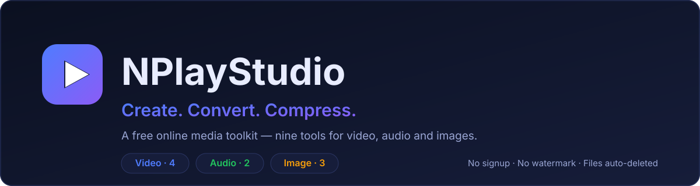

# NPlayStudio

**Create. Convert. Compress.**

Nine free tools for video, audio and images. FastAPI drives FFmpeg and Pillow,
Redis and ARQ run the jobs in the background, and SQLite keeps the task history.
No account, no watermark, no payment wall — uploads are deleted an hour after
processing.

[](https://github.com/NSKWeb/NPlayStudio/actions/workflows/deploy.yml)
[](https://www.python.org/)
[](https://fastapi.tiangolo.com/)
[](https://docs.docker.com/compose/)
[](LICENSE)

---

## What it is

A single web app that does the boring media chores without an account or a
watermark. You drop a file on a tool page, watch a real progress bar, and get
the result back.

| | |
|---|---|
| **9 tools** | 4 video, 2 audio, 3 image |
| **No signup** | No login, no email, no quota |
| **No watermark** | Output is clean |
| **Self-cleaning** | Every upload and output is deleted after 1 hour |
| **Real progress** | Read from ffmpeg's own `-progress` stream, not estimated |
| **Self-hosted** | Docker Compose plus nginx; runs on one small VPS |

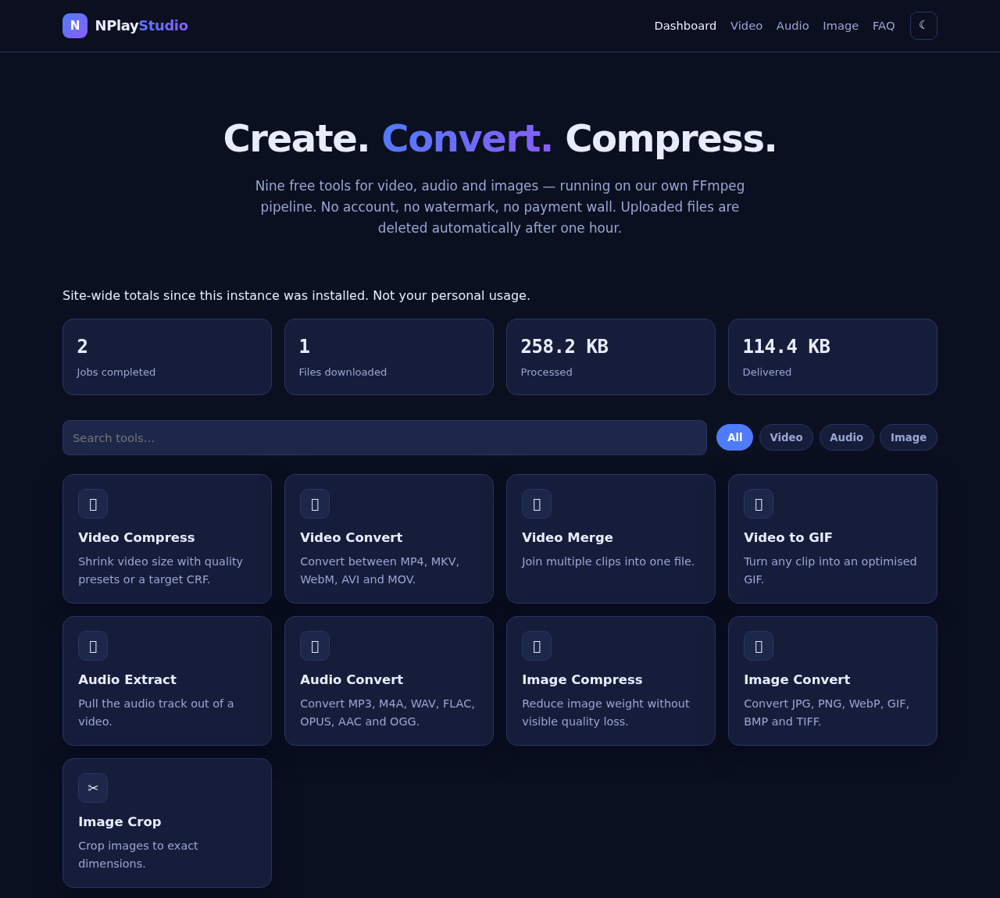

---

## The nine tools

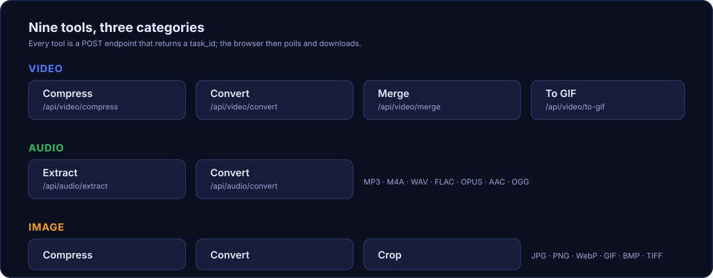

| Category | Tool | Endpoint | What it does |
|---|---|---|---|
| Video | Compress | `POST /api/video/compress` | Quality preset or explicit CRF, optional resize and codec |
| Video | Convert | `POST /api/video/convert` | MP4, MKV, WebM, AVI, MOV |
| Video | Merge | `POST /api/video/merge` | Join clips; stream-copy when they match, re-encode when they do not |
| Video | To GIF | `POST /api/video/to-gif` | Optimised GIF with a generated palette |
| Audio | Extract | `POST /api/audio/extract` | Pull the audio track out of a video |
| Audio | Convert | `POST /api/audio/convert` | MP3, M4A, WAV, FLAC, OPUS, AAC, OGG |
| Image | Compress | `POST /api/image/compress` | Quality and optional max-width, can re-container |
| Image | Convert | `POST /api/image/convert` | JPG, PNG, WebP, GIF, BMP, TIFF |
| Image | Crop | `POST /api/image/crop` | Exact `x`, `y`, `width`, `height` |

Every tool answers with a `task_id`. Supporting endpoints: `GET /api/status/{task_id}`,
`GET /api/file/{task_id}`, `GET /api/history`, `GET /api/stats`, `GET /api/tools`,
`GET /api/presets`, `DELETE /api/task/{task_id}` and `GET /health`. Interactive
docs live at `/docs`.

The frontend generates a random id per browser (`nplay.client` in `localStorage`)
and sends it as `X-Client-Id` on every request. `GET /api/history` returns only
the jobs carrying that id — without one it returns an empty list — and
`GET /api/file/{task_id}` refuses a task whose stored client id does not match,
via the header or the `client` query parameter the download link uses. Jobs
submitted straight to the API with no client id have no owner and stay
downloadable by anyone holding the id.

Here is a tool page — pick a file, choose options, press one button:

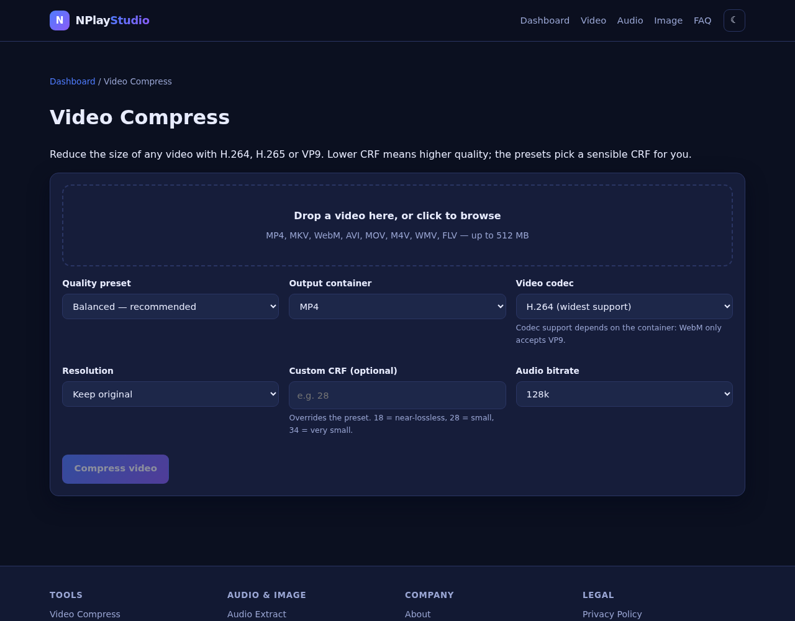

A few more, one from each category:

<table>
<tr>
<td width="50%">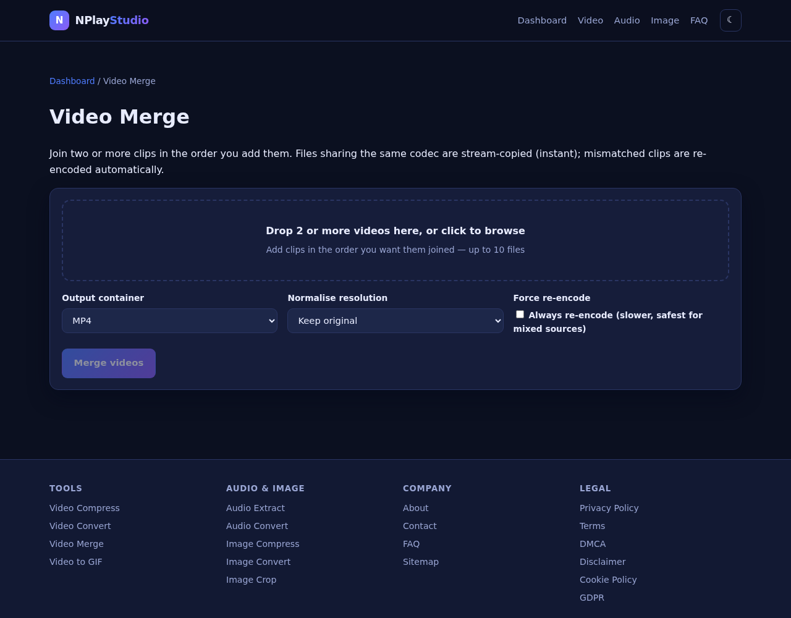</td>
<td width="50%">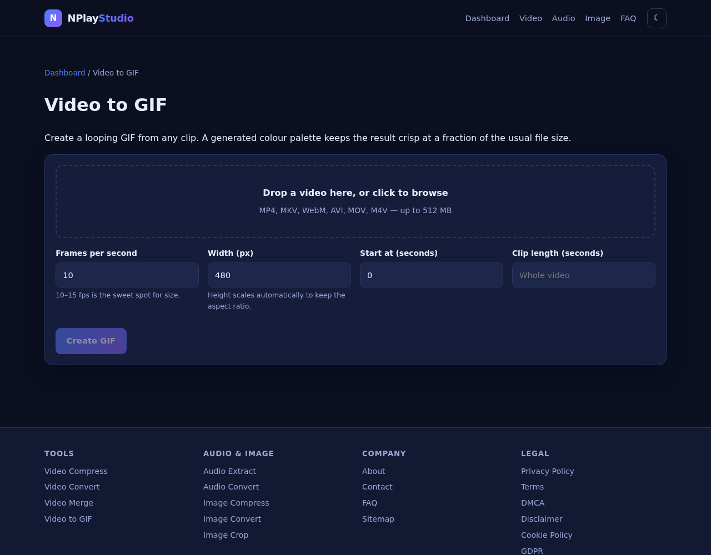</td>
</tr>
<tr>
<td>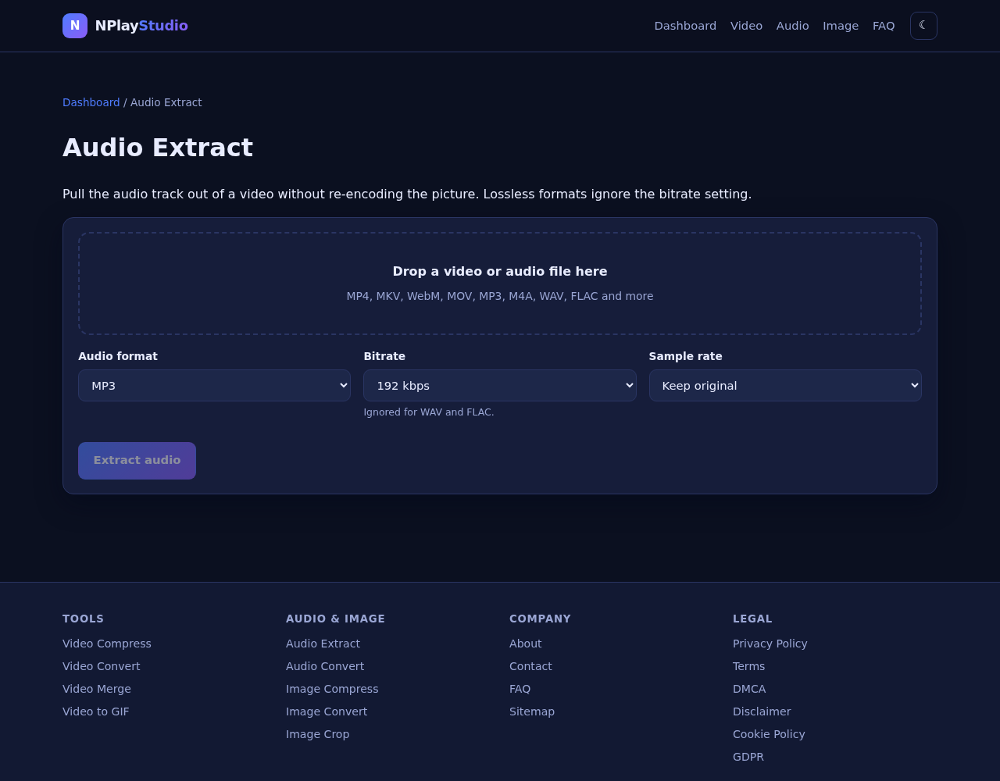</td>
<td>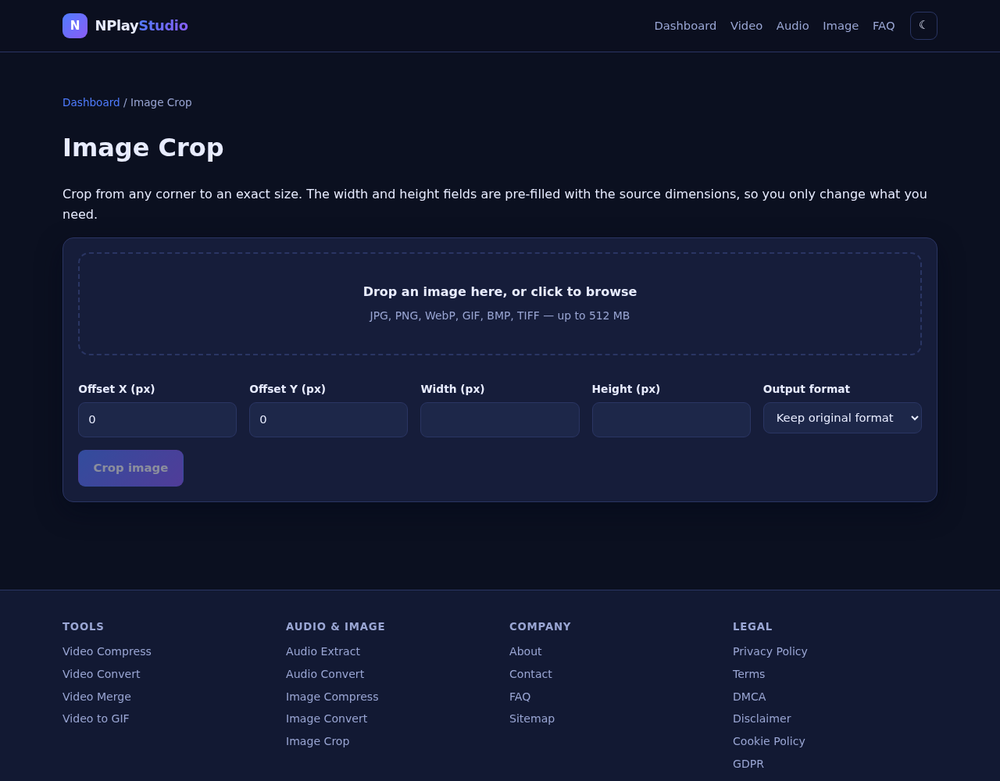</td>
</tr>
</table>

---

## How it works

### What happens to a file

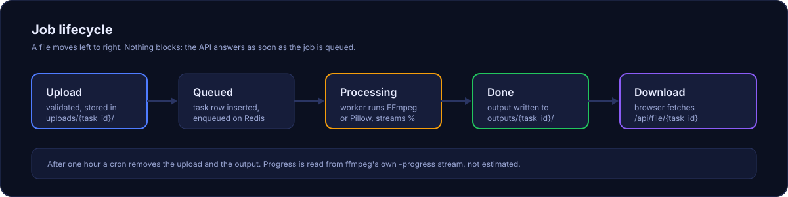

Upload → validate → store in `uploads/{task_id}/` → insert a `queued` task row →
enqueue on Redis → the worker flips it to `processing` and streams progress →
the output lands in `outputs/{task_id}/` → status becomes `done` → the browser
polls and downloads. A cron deletes anything older than the TTL.

Because the API returns as soon as the job is queued, a long encode never holds
an HTTP request open. The page polls `/api/status/{task_id}` and shows the
percentage the worker is reporting.

### What runs where

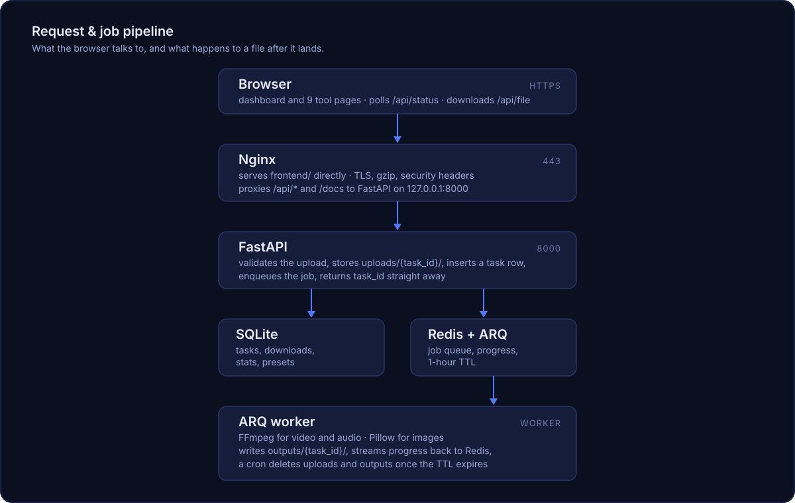

Nginx serves the static frontend itself and only proxies `/api/*` and `/docs` to
FastAPI, which is bound to loopback. The worker is a separate process, so a heavy
encode does not slow the API down.

### Design decisions worth knowing

- **Progress is real.** `-progress pipe:1` is parsed off ffmpeg's stdout; the
  percentage is encoded duration over input duration, capped at 99 until the
  process exits.
- **Merge tries the cheap path first.** Stream-copy is instant but only works
  when every input shares codecs, so a failure falls back to a normalising
  re-encode. Inputs with no audio track get generated silence, otherwise
  `concat` rejects the filtergraph.
- **Odd dimensions are normalised.** libx264 and libx265 refuse odd width or
  height, so every video is rounded down to even dimensions even when no resize
  was asked for.
- **Uploads are capped and type-checked** before anything is written to disk
  (`NPLAY_MAX_UPLOAD_MB`, `NPLAY_MAX_MERGE_FILES`).
- **The inline worker exists for development.** `NPLAY_INLINE_WORKER=true` runs
  jobs inside the API process so you do not need Redis locally. The test suite
  uses it; production should not.

---

## Quick start (local, no Docker)

Needs Python 3.12+, `ffmpeg` and Redis.

```bash
# 1. System dependencies (Debian/Ubuntu)
sudo apt-get install -y ffmpeg redis-server

# 2. Python dependencies
python3 -m pip install -r backend/requirements.txt

# 3. Configuration
cp backend/.env.example backend/.env

# 4. Run Redis, then the API and the worker in separate shells
redis-server --daemonize yes
python3 -m uvicorn backend.app.main:app --reload --port 8000
python3 -m arq backend.app.workers.tasks.WorkerSettings
```

Open <http://localhost:8000>.

### Running without Redis

Set `NPLAY_INLINE_WORKER=true` in `backend/.env`. Jobs then execute inside the
API process instead of going through the queue — convenient for development and
used by the test suite, but not suitable for production.

---

## Running with Docker

```bash
cp backend/.env.example backend/.env
docker compose up -d --build
docker compose ps
```

This starts three services: `redis`, `api` (port 8000, bound to loopback only)
and `worker`. Uploads, outputs and the SQLite file live in named volumes, so a
rebuild does not lose data.

---

## Configuration

All settings use the `NPLAY_` prefix and can be set in `backend/.env`.

| Variable | Default | Purpose |
|---|---|---|
| `NPLAY_ENV` | `development` | Environment label reported by `/health` |
| `NPLAY_HOST` / `NPLAY_PORT` | `0.0.0.0` / `8000` | Bind address |
| `NPLAY_DB_PATH` | `backend/data/nplaystudio.db` | SQLite file |
| `NPLAY_UPLOAD_DIR` | `uploads` | Incoming files |
| `NPLAY_OUTPUT_DIR` | `outputs` | Finished files |
| `NPLAY_REDIS_URL` | `redis://localhost:6379/0` | Queue backend |
| `NPLAY_QUEUE_NAME` | `nplaystudio` | ARQ queue name — the API and worker must agree |
| `NPLAY_MAX_UPLOAD_MB` | `512` | Per-file upload cap |
| `NPLAY_MAX_MERGE_FILES` | `10` | Files per merge |
| `NPLAY_FILE_TTL_SECONDS` | `3600` | How long files survive |
| `NPLAY_CLEANUP_INTERVAL_SECONDS` | `300` | Cleanup cadence |
| `NPLAY_CORS_ORIGINS` | `*` | Comma-separated allowed origins |
| `NPLAY_INLINE_WORKER` | `false` | Run jobs in-process (development only) |

---

## Tests

```bash
python3 -m pytest backend/tests -q
```

88 tests, no mocks. The suite generates real media with FFmpeg, uploads it
through a real HTTP client, lets the real worker process it, and checks the
downloaded bytes carry the right container signature. `test_units.py` covers the
SQLite layer and the service helpers directly.

---

## Deployment (VPS)

The quick path, on a fresh Debian/Ubuntu box:

```bash
sudo ./scripts/vps-bootstrap.sh nplaystudio.com you@example.com
```

That installs Docker, nginx and certbot, clones the repo to `/srv/nplaystudio`,
builds and starts the compose stack, puts nginx in front, and issues a
Let's Encrypt certificate. It is idempotent, so re-running it re-deploys. The
email argument is optional and only used for certbot expiry notices.

The manual equivalent:

1. **Harden the VPS.** Create a non-root user, disable password SSH login, and
   enable a firewall allowing only 22, 80 and 443.
2. **Install Docker** and the Compose plugin.
3. **Clone and configure.**
   ```bash
   git clone https://github.com/NSKWeb/NPlayStudio.git /srv/nplaystudio
   cd /srv/nplaystudio
   cp backend/.env.example backend/.env   # edit it
   ```
4. **Start the stack.**
   ```bash
   docker compose up -d --build
   ```
5. **Put Nginx in front.** On the first run the TLS server block cannot load
   before a certificate exists, so install the HTTP-only config first:
   ```bash
   sudo sed 's/nplaystudio\.example\.com/yourdomain.com/g' \
       nginx/nplaystudio.pre-certbot.conf > /etc/nginx/sites-available/nplaystudio
   sudo ln -sf /etc/nginx/sites-available/nplaystudio /etc/nginx/sites-enabled/
   sudo nginx -t && sudo systemctl reload nginx
   ```
6. **Get a certificate.**
   ```bash
   sudo certbot --nginx -d yourdomain.com --redirect
   ```
7. **Swap in the hardened config** (gzip, security headers, long proxy timeouts,
   `/docs` proxy) and reload:
   ```bash
   sudo sed 's/nplaystudio\.example\.com/yourdomain.com/g' \
       nginx/nginx.conf > /etc/nginx/sites-available/nplaystudio
   sudo nginx -t && sudo systemctl reload nginx
   ```
8. **Verify and back up.**
   ```bash
   ./scripts/smoke-test.sh yourdomain.com
   # nightly SQLite backup
   sqlite3 backend/data/nplaystudio.db ".backup '/var/backups/nplaystudio-$(date +%F).db'"
   ```

`scripts/smoke-test.sh <domain>` checks DNS, the certificate, the HTTP→HTTPS
redirect, every static page, the `/docs` proxy, the security headers, and a real
media job (upload → worker → download a valid MP4) through nginx. Pass `--local`
to test the nginx layer against `127.0.0.1` before DNS is live. It exits non-zero
on the first failure it finds.

`.github/workflows/deploy.yml` automates steps 3–4 on every push to `main`,
gated on the test suite. It expects the secrets `VPS_HOST`, `VPS_USER`,
`VPS_SSH_KEY`, `VPS_PORT` and `VPS_APP_DIR`; until `VPS_HOST` is set the deploy
job is skipped rather than failed.

### Before going live

Run the domain replacer, which rewrites the hostname in nginx, robots, the
sitemap and the legal pages, and derives `support@`, `dmca@` and `privacy@`
from the domain:

```bash
./scripts/configure-domain.sh nplaystudio.com               # role addresses
./scripts/configure-domain.sh nplaystudio.com you@mail.com  # one shared address
```

Then:

- Set your real AdSense publisher ID in `frontend/assets/app.js` (currently
  `ca-pub-0000000000000000`). Ads load only after a visitor accepts the consent
  banner, so nothing is requested until then.
- Serve over HTTPS only — the cookie banner and AdSense both expect it.

---

## Docs and legal pages

The site ships the pages a public tool site is expected to have. The screenshot
below is from a local run.

| Page | Path |
|---|---|
| Sitemap index (human-readable) | `/sitemap.html` |
| FAQ | `/faq.html` |
| About, Contact | `/about.html`, `/contact.html` |
| Privacy, Terms, DMCA, Cookie, Disclaimer | `/privacy.html`, `/terms.html`, `/dmca.html`, `/cookie.html`, `/disclaimer.html` |
| API docs (Swagger UI) | `/docs` |

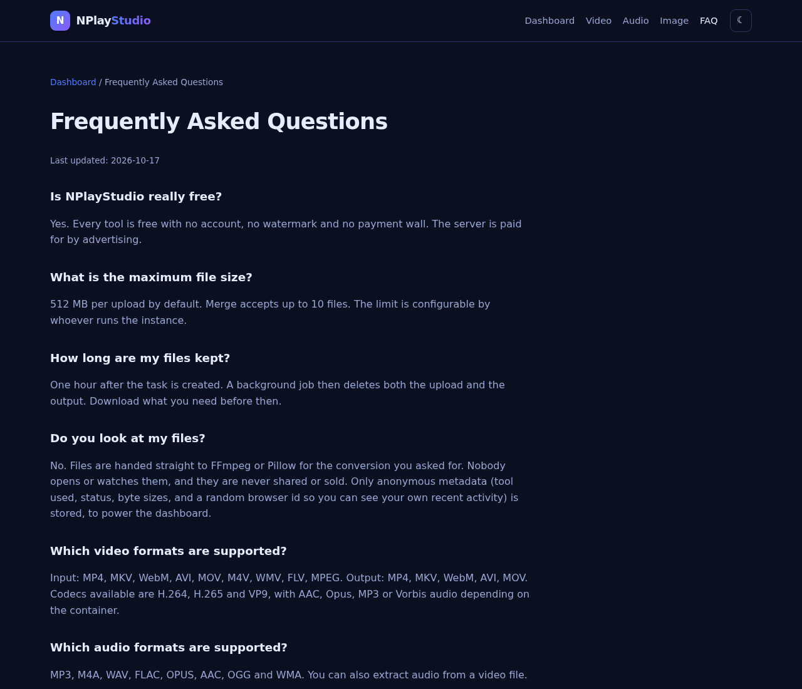

---

## Project layout

```
backend/app/
  config.py          settings
  database.py        SQLite schema + queries
  schemas.py         Pydantic request/response models
  routes/            video, audio, image, stats, history, common helpers
  services/          ffmpeg, pillow, file, db facades
  workers/tasks.py   ARQ job execution, progress, cleanup cron
backend/tests/       end-to-end and unit tests
frontend/            dashboard, 9 tool pages, legal pages, assets
nginx/nginx.conf     reverse proxy template
nginx/nplaystudio.pre-certbot.conf  HTTP-only config for the first certbot run
scripts/             configure-domain.sh, vps-bootstrap.sh, smoke-test.sh,
                     capture_screenshots.py
docs/                banner and diagram SVGs, README screenshots
Dockerfile           shared image for the API and the worker
docker-compose.yml   redis + api + worker
```

The screenshots in this README are not hand-made. Bring the stack up and run:

```bash
python3 scripts/capture_screenshots.py http://127.0.0.1:8000
```

It drives the system Chromium through Playwright, forces the dark theme, and
dismisses the cookie banner by presetting the app's own localStorage keys, so
the images show the real UI without a consent dialog in the way.

---

## License

MIT — see [LICENSE](LICENSE).
